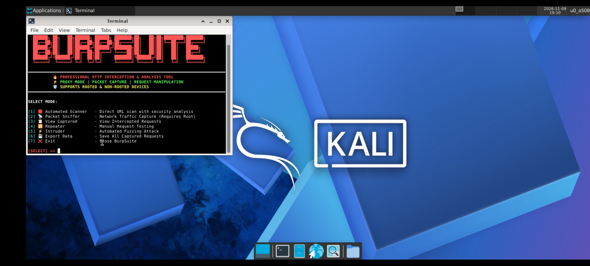
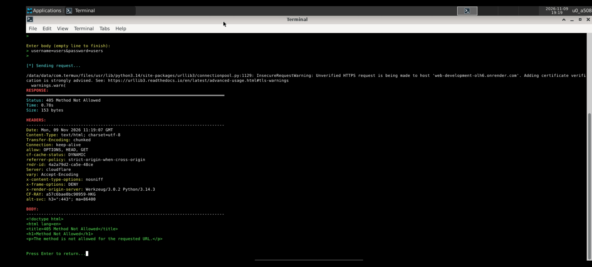

# Burp Suite Tool 🛡️

A comprehensive, lightweight, and powerful Python-based HTTP/HTTPS Proxy, Packet Capture, and Security Testing tool inspired by professional penetration testing suites. Designed for security analysis, traffic monitoring, and request manipulation across various environments (including Linux, Kali Linux, and Termux).

---

## 📸 Screenshots & Preview

### Main Dashboard & Menu Interface


### Execution & Traffic Monitoring


---

## ✨ Core Features & Capabilities

- 🔥 **Professional HTTP Interception & Analysis**: Inspect and modify HTTP/HTTPS requests and responses in real-time.
- ⚡ **Proxy Mode**: Acts as a middleman to capture web and application traffic.
- 📦 **Packet Capture & Logging**: Save and export captured network streams for detailed auditing.
- 🛡️ **Cross-Platform Support**: Fully compatible with standard Linux distributions, Kali Linux environments, and rooted/non-rooted mobile setups.

---

## ⚙️ Requirements & Dependencies

Before running the tool, ensure you have **Python 3.x** installed on your system.

### Installing Dependencies via `pip`
Install the required dependencies directly using `requirements.txt`:

```bash
pip install -r requirements.txt

🔍 How the Tool Works (Operational Workflow)
​When you launch burpsuite_tool.py, the application displays an interactive terminal dashboard featuring a banner and a primary selection menu. Here is a detailed breakdown of how each module operates:
​1. Automated Scanner ([1])
​How it works: Performs a direct security scan and automated vulnerability assessment on a target URL. It sends structured test payloads to detect common misconfigurations, security header flaws, or exposed entry points.
​2. Packet Sniffer ([2])
​How it works: Listens to active network interfaces or local sockets to capture live incoming and outgoing network traffic packets. (Note: Low-level packet capture on physical interfaces requires root/administrator privileges).
​3. View Captured ([3])
​How it works: Opens the session storage and logs of all previously intercepted or sniffed requests. It allows you to inspect full HTTP request headers, query parameters, request bodies, and server response codes.
​4. Repeater ([4])
​How it works: Enables manual request manipulation and re-transmission. You can load a captured request, edit its parameters, headers, or payloads on the fly, and resend it repeatedly to observe server response behavior.
​5. Intruder ([5])
​How it works: Executes automated fuzzing and custom brute-force testing. It iterates through wordlists or custom payload lists, injecting them into specified request fields to test for input validation vulnerabilities and weak endpoints.
​6. Export Data ([6])
​How it works: Compiles all session activity, captured request logs, and scan results into structured output files, making it easy to store evidence or prepare documentation for auditing.
​7. Exit ([7])
​How it works: Gracefully shuts down active proxy threads, releases allocated network sockets, saves session states, and exits the application clean.
​⚠️ Disclaimer
​This tool is created strictly for Educational Purposes and Authorized Penetration Testing. The author and contributors are not responsible for any misuse or damage caused by unauthorized systems scanning or attacks. Always ensure you have explicit permission before testing any target.
